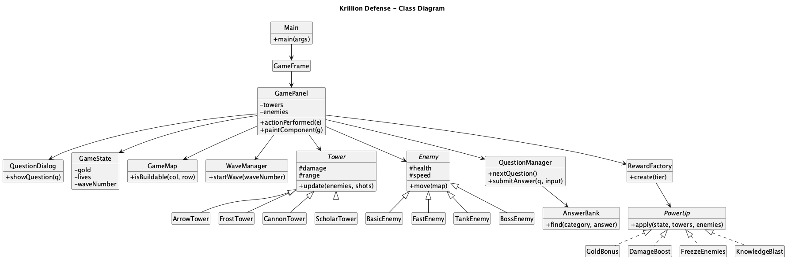
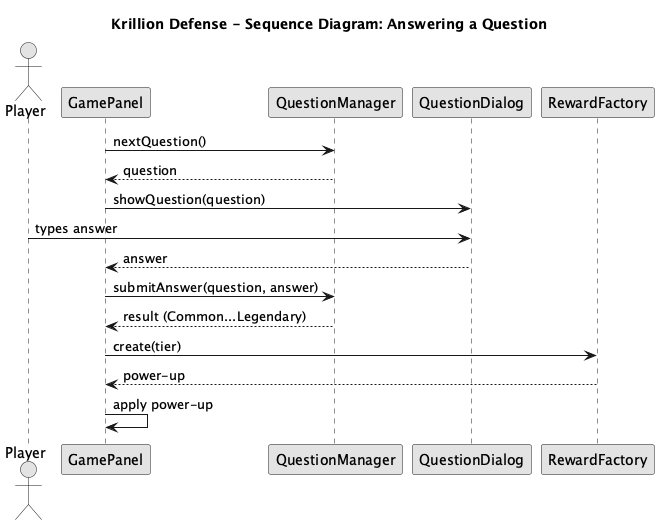
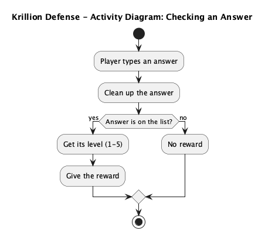

# Krillion Defense — CSEN 160 Project Design

## Overview

Krillion Defense is a 2D tower defense game in Java Swing where trivia answers power your defenses, and the more obscure your answer, the bigger the reward.

Enemies walk a fixed path toward your base, you spend gold to place towers, and you lose a life for every enemy that gets through. Every so often the game pauses and asks an open-ended prompt like "Name a country in Africa." Any correct answer counts, but common answers (South Africa, Nigeria) give small rewards, and rare answers (Eswatini, Djibouti) give big ones.

**MVP scope for Nov 13:** one map, Arrow + Frost towers, Basic + Fast enemies, ~5 waves, and the full question-and-scoring system with power-ups. Everything else is stretch.

## Core gameplay

- Start with 200 gold and 20 lives. 10 waves total (MVP: 5).
- **Map:** 20 × 12 grid of 40 px tiles (800 × 480) stored as `int[][]`: 0 = grass (buildable), 1 = path, 2 = base. The path is also an ordered `List<Point>` of waypoints.
- **Towers:** click a tower in the side bar, then a grass tile. Targets the enemy furthest along the path within range. Upgrade twice (+25% damage, +10% range per level).

| Tower | Cost | What it does |
| --- | --- | --- |
| Arrow Tower | 50 | Fast, single-target. The basic tower. |
| Cannon Tower | 100 | Slow, splash damage. |
| Frost Tower | 75 | Low damage, slows enemies 40% for 2 s. |
| Scholar Tower | Unlock only | Damage = 10 + knowledgePoints / 20. Unlocked by a Legendary answer. |

| Enemy | Health | Speed | Gold | Appears from |
| --- | --- | --- | --- | --- |
| Basic | 50 | normal | 5 | Wave 1 |
| Fast | 30 | 2× | 7 | Wave 3 |
| Tank | 200 | 0.5× | 15 | Wave 5 |
| Boss | 1000 | 0.5× | 100 | Wave 10 |

- **Waves:** enemies spawn one at a time with a delay; ~+15% health per wave.
- **Win/lose:** enemy reaching the base = −1 life (Boss −5). 0 lives = Game Over. Clear the last wave = Victory.

## Trivia: rarity scoring

**When questions appear:** at the start of every build phase, and from wave 3 on, one surprise question mid-wave (10–30 s in). The game pauses. 15 s timer, one answer.

**Data file** (`src/main/resources/answers.csv`):

```csv
category,answer,timesGiven
africa_countries,nigeria,1000
africa_countries,south africa,980
africa_countries,egypt,950
africa_countries,kenya,600
africa_countries,ghana,450
africa_countries,madagascar,300
africa_countries,eswatini,40
africa_countries,djibouti,25
alias,swaziland,eswatini
```

Counts are seeded by hand, then +1 each time an answer is given (saved to a copy in the user's home folder).

**Formula:** `score = max(5, round(100 * (1 - timesGiven / maxTimesGiven)))` where max is the most common answer in that category.

| Tier | Score | Example |
| --- | --- | --- |
| Common | 5–39 | Nigeria (5) |
| Uncommon | 40–69 | Kenya (40), Ghana (55) |
| Rare | 70–89 | Madagascar (70) |
| Legendary | 90–100 | Eswatini (96), Djibouti (98) |

**Checking an answer:**
1. Lowercase, trim, remove punctuation, drop leading "the ".
2. Replace aliases ("swaziland" → "eswatini").
3. Reject if already used this game.
4. Exact match, else Levenshtein distance ≤ 1 for answers longer than 4 letters.
5. No match or time up → Invalid, no reward, no penalty.

## Power-ups

| Tier | Reward (random from pool) |
| --- | --- |
| Invalid | Nothing |
| Common | +30 gold (`GoldBonus`) |
| Uncommon | +75 gold, or +25% tower damage for the wave (`DamageBoost`) |
| Rare | Free tower upgrade (`FreeUpgrade`), or freeze all enemies 5 s (`FreezeEnemies`) |
| Legendary | Unlock Scholar Tower (`UnlockScholarTower`), or 200 damage to all enemies (`KnowledgeBlast`) |

Each reward implements `PowerUp { void apply(GameState, List<Tower>, List<Enemy>); String getDescription(); }`. `RewardFactory.create(RarityTier)` picks one.

## Architecture

Plain Java 17+, Swing + Java 2D, no game engine. Base package `krilliondefense`.

| Package | Classes |
| --- | --- |
| `ui` | `Main`, `GameFrame`, `GamePanel`, `QuestionDialog` |
| `game` | `GameState`, `GamePhase`, `GameMap`, `WaveManager` |
| `entities` | abstract `Tower` (Arrow, Cannon, Frost, Scholar), abstract `Enemy` (Basic, Fast, Tank, Boss), `Projectile` |
| `trivia` | `QuestionManager`, `Question`, `AnswerBank`, `AnswerEntry`, `RarityScorer`, `RarityTier`, `AnswerResult` |
| `powerups` | `PowerUp`, `RewardFactory`, 6 power-up classes |

**Game loop:** `GamePanel extends JPanel` owns a `javax.swing.Timer` (16 ms). Each tick: spawn → move enemies → towers fire → projectiles hit → check wave end / game over / surprise question → `repaint()`.

**Questions:** stop the timer, set phase `QUESTION` (remember `previousPhase`), open modal `QuestionDialog`, send the answer to `QuestionManager.submitAnswer`, apply the `PowerUp`, restart the timer.

The `trivia` package must not use any Swing classes, so it can be unit tested on its own.

## UML diagrams

See `docs/uml`. The code should match these diagrams.





## JUnit 5 tests

| Test class | Checks |
| --- | --- |
| `RarityScorerTest` | normalize; min score 5; 40/1000 → 96; tier boundaries 39/40, 69/70, 89/90; close-match "madagaskar" true, "chad"/"char" false |
| `AnswerBankTest` | loads test CSV; finds known answer; null for unknown; alias works; `recordAnswer` +1 |
| `QuestionManagerTest` | rare answer → Legendary; repeat → Invalid; empty → Invalid |
| `RewardFactoryTest` | each tier gives a PowerUp (Invalid → null) |
| `GameStateTest` | `spendGold` fails when too low; lives to 0 → game over |
| `TowerTest` | upgrade +25%, max level 3; `findTarget` picks furthest in range |
| `EnemyTest` | dies at 0 health; reaches end of a 3-waypoint path |
